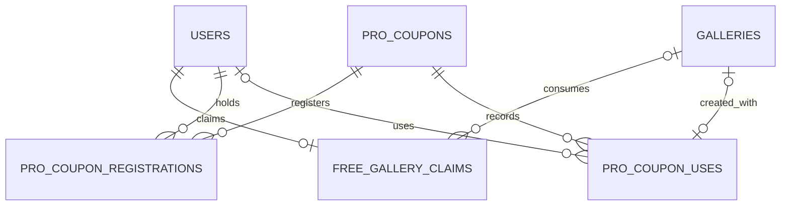

# 이용권·쿠폰

쿠폰 코드, 계정별 등록, 실제 갤러리 사용을 나눠 저장한다.

| 테이블 | 의미와 제약 |
|:---|:---|
| `free_gallery_claims` | 계정의 무료 개설 사용 기록 |
| `pro_coupons` | 코드·사용 정책·사용 마감·활성 상태·사용 횟수 |
| `pro_coupon_registrations` | 쿠폰·계정 조합은 유일 |
| `pro_coupon_uses` | 실제 사용 갤러리·사용 시각·이용 만료. 갤러리는 한 번만 연결 |

V44는 기존 1회용 쿠폰을 보존하면서 공유 정책과 사용 이력을 추가한다. 쿠폰 행 잠금 아래 정책·마감 검사와 갤러리 개설·사용 기록을 처리하므로 실패한 개설은 사용 횟수에 남지 않는다. 쿠폰 등록만으로 갤러리가 만들어지지 않는다.

[플랜 정책](../product/policies.md) · [서버 #327](https://github.com/organic-agent/organic-agent-server/pull/327) · [V44](https://github.com/organic-agent/organic-agent-server/blob/497c8af/wes-api/src/main/resources/db/migration/V44__reusable_pro_coupons.sql)
