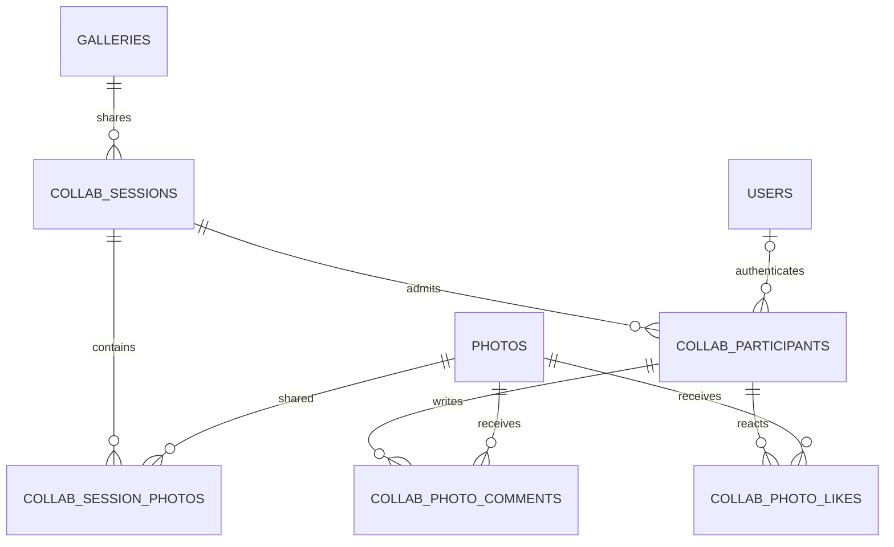

# 공유폴더·참여자·반응

공유폴더는 사진 ID 목록을 따로 보관하고, 사용자와 게스트의 반응을 통합 참여자로 연결한다.

- `collab_sessions` : 공유 링크·만료·폐기를 관리한다.
- `collab_session_photos` : 세션·사진 ID를 보관한다. 세션·사진의 갤러리 일치는 복합 FK로 제한한다.
- `collab_participants` : USER는 사용자 ID, GUEST는 게스트 토큰을 가진다. 두 신원은 상호 배타적이다.
- `collab_photo_comments/likes` : 참여자별 반응이다. 활성 좋아요는 세션·사진·참여자당 하나다.

V36에서 기존 컨셉 연결의 사진 목록을 고정하고, V37에서 `concept_folder_id`를 제거했다. **폴더 이동·삭제가 공유폴더와 반응을 함께 없애던 설명은 이전 계약**이다. 공유 가능한 사진과 링크 상태는 접근 시 검사한다. 잘못된 Bearer를 게스트로 강등하지 않는다.

근거 : [V36](https://github.com/organic-agent/organic-agent-server/blob/497c8af/wes-api/src/main/resources/db/migration/V36__freeze_concept_linked_shared_folders.sql), [V37](https://github.com/organic-agent/organic-agent-server/blob/497c8af/wes-api/src/main/resources/db/migration/V37__drop_collab_sessions_concept_folder_id.sql). [공유 화면](../product/flows.md)
