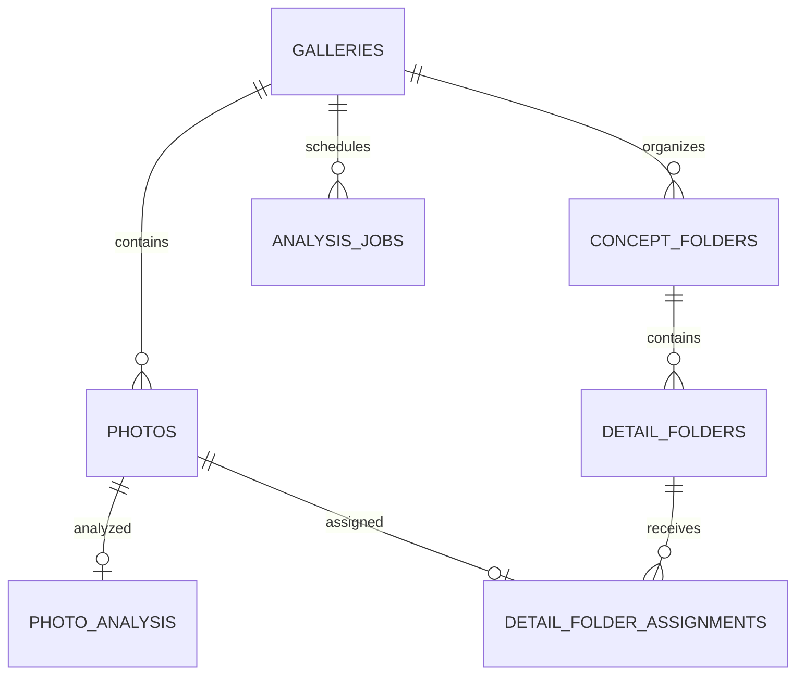

# 사진·AI 분석·폴더

사진별 분석 신호와 사람이 편집하는 폴더는 별도 데이터다. 작업 상태는 서버가 소유한다.

| 테이블 | 책임 |
|:---|:---|
| `photos` | 업로드 객체·미리보기·EXIF·배정 시각 |
| `photo_analysis` | DINOv3/CLIP 벡터, 품질 신호, 연사·그룹·후속 순위 |
| `analysis_jobs` | 서버가 관리하는 분석 실행·진행·실패·재시도 |
| `concept_assignments` | AI가 만든 컨셉·세부 이름표, 폴더 물질화의 입력 |
| `concept_folders`, `detail_folders` | 사용자가 편집하는 폴더 |
| `detail_folder_assignments` | 사진과 세부 폴더의 단일 배정 |

V23에서 분석 잡·이름표·세부 배정 테이블과 `pipeline_version`, `burst_id`, `burst_rank` 이름을 정리했다. V17에서 제거한 분류 작업 테이블과 이전 cluster API는 현재 모델에 넣지 않는다.

사진은 세부 폴더 하나에 배정되거나 미분류다. 갤러리 경계의 복합 FK는 마이그레이션이 보장하는 관계에만 적용된다. 폴더 준비와 화질·추천 순위 준비는 별도다.

`photo_labels`는 V46 개발 스키마다. main의 테이블로 표시하지 않는다. 라벨은 겹치는 속성, 폴더는 사진 분할이며 [용어집 D10](../glossary.md)을 따른다.

[AI 처리 흐름](../tech/ai-pipeline.md) · [V23](https://github.com/organic-agent/organic-agent-server/blob/497c8af/wes-api/src/main/resources/db/migration/V23__glossary_names.sql) · [구현 상태](../implementation-status.md)
