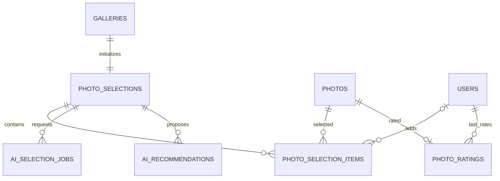

# 셀렉션·추천

갤러리에는 공동 셀렉 하나가 있고, 추천은 사용자가 검토할 후보로 저장한다.

| 테이블 | 책임 |
|:---|:---|
| `photo_selections/items` | 선택 상태·사진·순서·추가자 |
| `photo_ratings` | 사진당 공동 별점 1-5와 마지막 작업자 |
| `ai_selection_jobs` | 추천 작업·분석 잡 참조·회차 |
| `ai_recommendations` | 추천 사진·점수·순위 |
| `photo_memos`, `photo_comments` | 사진 메모와 고객 측 댓글 |

선택 사진과 순서는 셀렉 안에서 중복하지 않는다. 사용자 별점 분리는 아직 구현 정책이 아니다. 선택 제출과 개인 요청서 내보내기는 편집을 잠그며, 취소 가능 여부는 갤러리 유형·보정본 상태에 따라 판단한다.

서버 #362는 선택·별점 변경 번호와 마지막 작업자 정보를 제공한다. 번호가 달라지면 해당 목록을 다시 읽는 계약이며 Web 연동 완료는 별도다. V33에서 추천 이유·자연어 요청 컬럼과 미사용 선호 모델 테이블을 제거했으므로 이전 추천 문장·학습 테이블을 현행 ERD에 넣지 않는다.

관리자 셀렉 이력은 main에 남아 있다. develop V49는 관리자 출처 이력과 보정 회차의 이력 FK를 제거하지만 AI 초안은 유지한다. [관리자 브랜치 차이](../tech/backoffice.md)

근거 : [변경 조회 #362](https://github.com/organic-agent/organic-agent-server/pull/362), [내보내기 취소 #334](https://github.com/organic-agent/organic-agent-server/pull/334), [V33](https://github.com/organic-agent/organic-agent-server/blob/497c8af/wes-api/src/main/resources/db/migration/V33__drop_unused_recommendation_schema.sql).
